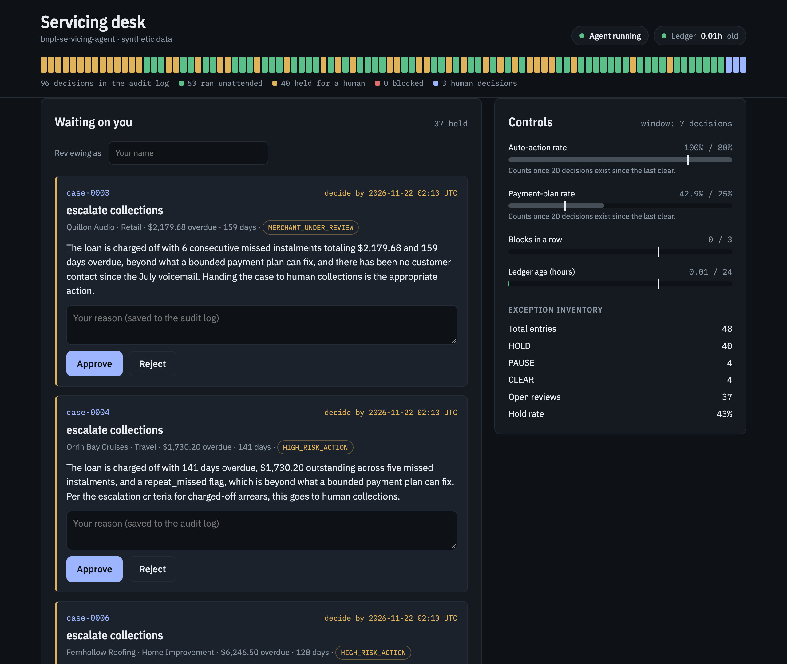

# bnpl-servicing-agent

**A bounded AI agent that works buy-now-pay-later payment exceptions, with a human at the gate.**

It reads a governed ledger, proposes one action per case, and a deterministic guardrail
decides what may run unattended. Anything risky waits for a named person. Detective
controls watch the agent itself and pause it when its behaviour drifts. Every claim
below is measured by a frozen eval that runs end to end for $0.

<!-- generated:numbers -->
| Metric | Result |
|---|---|
| Action accuracy | **97.8%** (45/46) |
| False-auto rate | **0.0%** (0/48) |
| Hold accuracy | **100.0%** (of 8 ambiguous) |
| Pause detection | **100.0%** (of 6 controls) |
| Guardrail BLOCK rate | **100.0%** (of 2 out-of-mandate) |
| LLM cost | **$0.0000** |
| Runtime | **0.3s** |

From [`evals/reports/2026-11-21-stub.json`](evals/reports/2026-11-21-stub.json): stub mode replaying a recorded live run of `claude-haiku-5-5` (prompt v2) over the 48-case golden set.
<!-- /generated:numbers -->



## What it does

- **Proposes, never decides alone.** Claude reads one case (loan, payments, the
  customer thread) and proposes exactly one action from a fixed set, with a rationale.
- **A guardrail with no model inside.** Every proposal gets `ALLOW`, `HOLD` or `BLOCK`
  and a machine-readable reason code. Same inputs, same verdict.
- **A person at the gate.** Held cases name their owner and a deadline. Approving runs
  the action under that person's name; rejecting runs nothing. Both need a reason.
- **Controls that watch the agent.** Rate thresholds, an exception inventory, alerts,
  and an auto-pause that only a named human can clear.
- **Governed data, enforced by the database.** The agent reads only through SQL views
  and can only append to the audit log. SQLite's authorizer refuses anything else.

## Architecture

```
          ┌──────────── governed ledger (SQLite) ────────────┐
          │ views only · append-only audit log + exceptions  │
          └───────────────┬─────────────────────▲────────────┘
                          │ read                │ append
   ┌──────────────────────▼─────────────────────┴───────────────────────┐
   │ LangGraph loop:  fetch ──► propose ──► guardrail ──┬─► act (ALLOW)  │
   │                    │       (Claude)   (no LLM)     └─► hold (HOLD,  │
   │                    └── paused? stop, spend nothing      BLOCK)     │
   └───────────────────────────────────────┬────────────────────────────┘
                                           │ held cases
     bnpl controls digest ◄── thresholds ──┼──► review queue ──► human approves
     (alert · BREACH · PAUSE)              │    (CLI · API · dashboard) or rejects
                                           ▼
                        frozen golden set ──► eval harness ──► committed reports
```

## The mandate

<!-- generated:mandate -->
| Action | Meaning | Risk | Handling |
|---|---|---|---|
| `nudge` | Send a payment reminder to the customer | Low | Auto, at most 1 per customer per day |
| `offer_plan` | Offer a revised payment plan (longer term / lower instalment) | Medium | Auto only inside bounds (term extension ≤ 3 months, no fee waiver); otherwise HOLD |
| `escalate_collections` | Hand the case to human collections | High | Always HOLD for the servicing lead |
| `hold_for_review` | Agent abstains — the case is ambiguous | — | Goes to the review queue |
| `no_action` | Case is resolved or a false alarm | Low | Auto, with a logged reason, only when nothing is overdue on the record; otherwise HOLD |

Escalation owner: the servicing lead, who has 24 hours to decide each held case. The agent pauses itself and raises an alert when any of these is true:

1. The ledger is more than 24 hours old.
2. More than 80% of its last 100 decisions ran unattended.
3. More than 25% of them were payment plans.
4. A merchant is under review: all of that merchant's cases hold.
5. The guardrail has blocked it 3 times in a row.

Rate controls start counting once 20 decisions exist since the last time a human cleared a pause.
<!-- /generated:mandate -->


## Run it

```bash
uv venv --python 3.12 && uv pip install -e ".[dev]"
.venv/bin/bnpl seed --reset                  # synthetic ledger, seed 42
.venv/bin/bnpl run                           # work the queue ($0: replays a recorded live run)
.venv/bin/bnpl evals run                     # the golden-set eval, $0
.venv/bin/bnpl serve                         # dashboard at http://127.0.0.1:8000
```

Then `bnpl review list`, `bnpl review approve <case> --actor "You" --reason "…"`,
`bnpl controls digest` and `bnpl controls clear-pause`. Live mode
(`--mode live`) needs `ANTHROPIC_API_KEY` in `.env` and is capped by
`BNPL_DAILY_SPEND_CAP_USD`.

## How the eval stays honest

- The golden set (`evals/golden_cases.json`) is hand-written and frozen by hash. The
  harness refuses to run if it changes.
- The headline numbers come from **stub mode**: a recorded live run replayed for $0,
  so anyone can reproduce them. The live runs are committed alongside.
- The first live run **failed** the false-auto gate. The fix was to the agent (a
  stricter `no_action` rule and a revised prompt), never the golden set. Both runs are
  kept. Because the prompt was revised after seeing the set, treat the accuracy as an
  in-sample score, not a held-out one.
- Two control cases hand the agent a deliberately bad proposal to prove the guardrail
  blocks it; they are excluded from action accuracy.

<!-- generated:history -->
| Report | Mode | Prompt | Accuracy | False-auto | Gate |
|---|---|---|---|---|---|
| [`2026-11-21-live.json`](evals/reports/2026-11-21-live.json) | live | v1 | 91.3% | 2 | **fail** |
| [`2026-11-21-live-2.json`](evals/reports/2026-11-21-live-2.json) | live | v2 | 97.8% | 0 | pass |
| [`2026-11-21-stub.json`](evals/reports/2026-11-21-stub.json) | stub | v2 | 97.8% | 0 | pass |
<!-- /generated:history -->

## Merchant reports: a second agent, same rules

A weekly portfolio-health summary for one merchant, written by Claude from governed
metrics only (delinquency, plan uptake, disputes, fraud flags, held exceptions). The
same idea as the servicing agent: the model proposes, a deterministic guardrail decides.
It blocks any report that states a number not in the metrics or the published policy,
names a customer, or uses an action outside the report mandate. It holds stale data, a
merchant under review, a risk level lower than the metrics show, and anything external
or escalated. It has its own frozen golden set and gate: no report that must hold may
publish (false-publish = 0).

<!-- generated:merchant -->
| Report | Mode | Risk accuracy | Action accuracy | False-publish | Controls | Grounding blocks | Gate |
|---|---|---|---|---|---|---|---|
| [`2026-11-21-merchant-live.json`](evals/reports/2026-11-21-merchant-live.json) | live | 90.0% | 90.0% (9/10) | 0 | 100% (4) | 4 | pass |
| [`2026-11-21-merchant-stub.json`](evals/reports/2026-11-21-merchant-stub.json) | stub | 90.0% | 90.0% (9/10) | 0 | 100% (4) | 0 | pass |

| Action | Meaning | Risk | Handling |
|---|---|---|---|
| `no_change` | Portfolio is healthy; publish the summary | Low | Auto-publish if every number is grounded |
| `monitor` | Watch a rising metric next week | Low | Auto-publish if every number is grounded |
| `review_with_merchant` | Raise disputes or arrears with the merchant | Medium | Always HOLD for the portfolio risk lead: it is an external conversation |
| `escalate_to_risk` | Escalate the merchant to portfolio risk | High | Always HOLD for the portfolio risk lead |
<!-- /generated:merchant -->

In the first live run the guardrail blocked sound reports that quoted a policy
threshold ("below the monitoring threshold", with its percentage). That was the
guardrail being too strict, so published thresholds now count as grounded. The stub
row replays the same recorded reports under the fixed guardrail; the live row is kept
as it ran.

## The agent's tools over MCP

`bnpl mcp` serves the agent's tools to any MCP client over stdio: `get_case`,
`list_exceptions`, `propose_action` and `submit_for_review`. A client's proposal runs
through the same governed ledger, guardrail, pause conditions and review queue as the
built-in agent, so it cannot execute anything the guardrail would hold or block.

## How it was built

From a written spec, phase by phase, with an AI coding agent and a human review between
phases. Each phase had a check that had to pass before the next began. The spec, and a
record of every place the build departed from it, is in
[docs/build-spec.md](docs/build-spec.md).

## Project layout

```
bnpl/          agent loop, guardrail, mandate, governed ledger, review, controls, CLI, API,
               merchant-report agent, MCP server
bnpl/dashboard static dashboard served by the API (no build step)
evals/         golden set, harness, reports, recorded model responses
tests/         unit and end-to-end tests
```

## Notes

- **Synthetic data.** Every merchant, customer, loan and message is generated from a
  fixed seed. No real customer or merchant data is used.
- **Not affiliated.** This is a portfolio demonstration of the agent patterns described
  in a public Forward Deployed Engineer job description from ClarityPay. It is not
  affiliated with, endorsed by, or built for ClarityPay, and it is not deployed or used
  by any lender. It is not production-ready.
- **License.** MIT; see [LICENSE](LICENSE).
